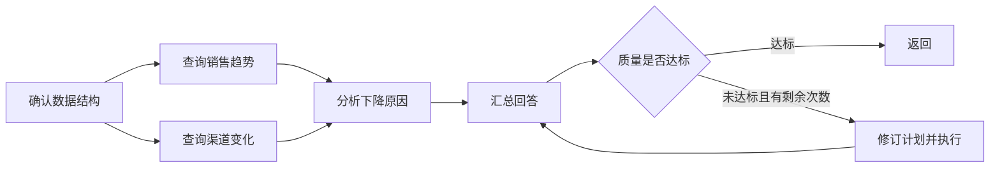

# 多步骤任务编排：本轮问答记录

日期：2026-10-14。范围：`agentscope-platform` 的实现说明、优化讨论和本轮交付。

本文按对话顺序整理关键问答，不是逐字转录。前两问描述改造前的代码；第三问记录随后实施的结果。当前运行语义以 [DAG 编排指南](../../dag-orchestration.md) 为准。

## 问题一：多步骤任务编排怎么实现的？

**用户原问：** 多步骤任务编排怎么实现的

**答复要点：** 项目采用 DAG（有向无环图）调度，AgentScope 执行各个节点，之后汇总并评审答案。任务间调度由本项目应用服务负责。

### 1. 目标转为任务和依赖

- `POST /agent/dag/run`：调用方直接提交任务列表。
- `POST /agent/dag/plan-run`：只提交目标，Planner 生成结构化计划。
- 每个任务有 `id`、`description`、`dependsOn`。规划失败或空计划按既有规则回退为单任务；未配置模型、取消等不能被静默掩盖。

例如“分析销售下降原因”可拆为：

### 2. 原实现按拓扑层执行

执行器检查任务数量、必填字段、重复 ID 和循环依赖，然后分层。同层使用 `asyncio.create_task()` / `gather()` 并行，层间串行，Semaphore 限制 worker 并发。整层完成后才能进入下一层。

每个节点接收原始目标、自己的任务描述，以及直接上游的结果。节点内部再通过 AgentScope 的推理/工具调用循环完成任务。因此有两个层次：DAG 管理任务依赖，Agent 管理一个任务内部的多轮执行。

### 3. 汇总和质量闭环

所有任务结束后再执行 synthesis。开启评审时，Critic 对正确性、完整性、清晰度评分；默认接受阈值 0.75，最多重新规划一次。原实现重跑整个修订 DAG，每轮记录在 `attempts`，是否达标由 `acceptedByThreshold` 表示。

### 4. 异步生命周期

DAG 两个入口均有 `/async` 版本，提交返回 202。默认 inline 模式由 Python 执行，Java `async-task-service` 保存任务状态、进度、终态和 webhook。Python 续租，客户端通过 SSE 观察或显式取消。

原实现的限制包括：失败节点仍可进入下游和汇总；未捕获的编排异常会取消同层其他工作；inline 进程崩溃不具备 DAG 节点级续跑能力。

**当时核对的文档差异：** 早期 DAG 文档仍把异步入口列为“尚未迁移”，但代码中已经实现。本轮已纠正文档。

代码入口：[DAG 服务](../../../src/agentscope_platform/application/dag.py)、[规划服务](../../../src/agentscope_platform/application/planning.py)、[AgentScope runner](../../../src/agentscope_platform/infrastructure/agentscope/runner.py)。这些链接指向当前代码，不是历史快照。

## 问题二：这部分可以优化的点在哪里？

**用户原问：** 这部分可以优化的点在哪里

**答复要点：** 先优化正确性和能力边界，再优化速度、成本和恢复。

| 优先项 | 改造前的问题 | 建议 |
|---|---|---|
| 失败传播 | ERROR/TIMEOUT 后仍执行下游，文本输入缺失明确状态 | 显式节点状态，必需依赖失败后跳过；区分执行完成、部分完成和质量达标 |
| 汇总能力 | synthesis 与 worker 共用带工具 runner | 使用无工具汇总；服务端限制能力，不能只依赖提示词 |
| 调度 | 整层屏障拖慢已经就绪的后继 | 改为依赖完成立即调度；排队、开始和完成事件反映真实状态 |
| 整体预算 | 规划、多个 worker、汇总、评审和重规划叠加调用 | 整次运行共用截止时间和模型预算；并发、租户资源受限 |
| 评审与重规划 | Critic 主要看最终答案，重规划重跑全图 | 增加节点状态与工具证据；确定性门禁先行；安全结果按条件复用 |
| 节点恢复 | 任务持久化不等于节点断点恢复 | 长任务确有需求时，再设计中央检查点、版本绑定、租约及真实恢复验证 |

调度收益示例是一个假设：A 用 2 秒、C 依赖 A 用 3 秒，独立 B 用 20 秒。层屏障可能让整体约 23 秒；就绪调度可让 C 提前启动，整体约 20 秒。这不是本项目实测性能。

进一步核对发现，通用 DAG 与 Process 原本各自创建 Semaphore，并不是所有编排入口共享一个进程级上限。规划时也明确，简单单任务直接返回、按任务类型选择评审等优化需要保持最终回答语义，不能只为了减少调用破坏契约。

**建议顺序：** 失败传播与无工具汇总 → 就绪调度和总预算 → 证据评审、局部重规划 → 有条件的节点持久恢复。

## 问题三：按照你的建议开始出执行计划，然后开始执行

**用户原话：** 按照你的建议开始出执行计划，然后开始执行

**执行答复：** 读取项目进度和 Git 状态，基于 `4c5f673` 建立 `refactor/dag-orchestration` 分支；基线 530 项测试通过。计划先落盘，再按测试保护、小批次实施、验证和提交连续推进。完整计划见 [PLAN.md](PLAN.md)。

### 本轮已实施

| 阶段 | 实际结果 |
|---|---|
| S1 | 失败依赖传播为 SKIPPED；结构化状态证据；无工具 synthesis；服务端能力限制；非 DONE 综合结果不能记为异步 SUCCEEDED |
| S2 | 依赖就绪调度；通用/Process 共享 worker 上限；租户并发和等待队列上限；真实进度事件；取消/异常收敛 |
| S3 | Planner 到评审共享截止时间；实际模型边界限制调用数及保守 token 预留；原有 Java 租户配额继续生效 |
| S4 | Critic/Replanner 读取节点证据；必需节点失败直接零分；同请求内 TTL 有界复用，输入或依赖执行版本变化时失效 |
| S5 | 全量验证、旧模式/优化模式离线对照、运行与回滚说明、分批 Git 交付 |

### 本轮的具体取舍

- `AGENT_DAG_OPTIMIZATION_ENABLED` 默认 false。HTTP/JSON 字段保持不变，新语义显式启用。
- 优化模式拒绝未知依赖；兼容模式保留旧行为。
- 通用优化 DAG 只允许服务端内置只读能力；Process 保留已有开关、确认和幂等约束下的退款发起，并禁止重规划写能力。
- 结果复用默认最多 30 秒，可设 TTL=0 关闭；只允许无工具推理或 rag_search/schema_explore。时钟、订单、流程状态、analytics_sql、未知及写工具不复用。
- 简单单任务仍保留汇总，避免把子任务回答直接当作最终回答改变契约。
- Token 预算采用保守预留，不冒充精确计费；网关内部重试也不等于本地 SDK 调用数。
- 并发限制是每进程的 DAG worker 范围，不宣称跨副本全局限额。

### 验证与交付

最终本地 569 项测试通过，覆盖率 89.66%；Ruff、格式、Mypy、契约快照、离线 Shadow、包构建和 Compose 校验通过。新增优化 suite 有 3 个只读场景，旧模式和优化模式实际 ASGI 应用对照共 6 个样本通过。

源码提交 `82651a7` 已合入推送 `origin/main`；[源码 CI](https://github.com/lirji/platform-agentscope/actions/runs/38529981435) 全部通过，包括镜像漏洞扫描。后续提交为交付记录和本问答文档。

没有执行生产部署、生产流量切换或真实付费模型验收。Code Hygiene 自动发现未识别 Ruff formatter，但实际仓库格式检查已独立通过；报告保留这一工具限制。

### 尚未实施的条件阶段

S6 节点持久恢复需要 Java 中央任务服务新增版本化契约、原子 lease epoch 校验及隔离环境恢复演练。本轮只完成 [恢复设计与前置条件](RECOVERY_DESIGN.md)，没有将轮内缓存当作持久恢复，也没有新增第二任务权威。

真实 Java/Python 模型双跑、生产灰度、性能实测和节点恢复演练仍需后续具备环境与授权后推进。

## 问题四：把本次问答记录到文档

**用户原话：** 稍后顺便把本次我们的问答记录在文档中

**答复与落实：** 将本轮问答按上述顺序整理到本文件，区分改造前的实现、提出的建议、已经完成的代码与条件阶段，并在项目文档入口和交付记录中建立链接。

## 相关文档

- [执行计划](PLAN.md)
- [实施和验证证据](RESULT.md)
- [重构报告](PROJECT_REFACTORING_REPORT.md)
- [节点恢复设计](RECOVERY_DESIGN.md)
- [当前 DAG 编排指南](../../dag-orchestration.md)

## 问题五：仅完成设计是否意味着没有编写恢复代码

**用户原话：** 节点级持久恢复目前只完成设计，等待中央服务契约和恢复演练条件。意思是还未执行编写代码的工作吗

**当时答复：** 是，上一轮仅节点持久恢复未写代码；S1–S5 已落地。轮内缓存不能在进程重启后恢复。

## 问题六：本次出计划后开始实现

**用户原话：** 本次开始实现这部分，先出执行计划，然后开始实施；随后要求“继续”。

**本轮落实：** 新增中央版本化检查点与事务fencing、Python节点/规划/汇总/评审恢复、跨重启预算及兼容分发。已通过真实MySQL及独立worker强制终止接管；详情见 [本轮报告](../dag-recovery/ENTERPRISE_FEATURE_REPORT.md)。因此上文“尚未实施”只描述上一轮交付状态。本轮仍未启用生产；写节点恢复不在只读协议范围内。

## 问题七：默认开启功能并推送远程

**用户原话：** 默认开启功能，然后推送到远程

**落实范围：** API/worker 的节点恢复与优化调度默认开启，Compose 与环境模板同步；inline 保持原行为，支持显式关闭回退。验证和 Git 交付见 [默认启用记录](../dag-recovery/DEFAULT_ENABLEMENT.md)。本轮不执行生产部署。
